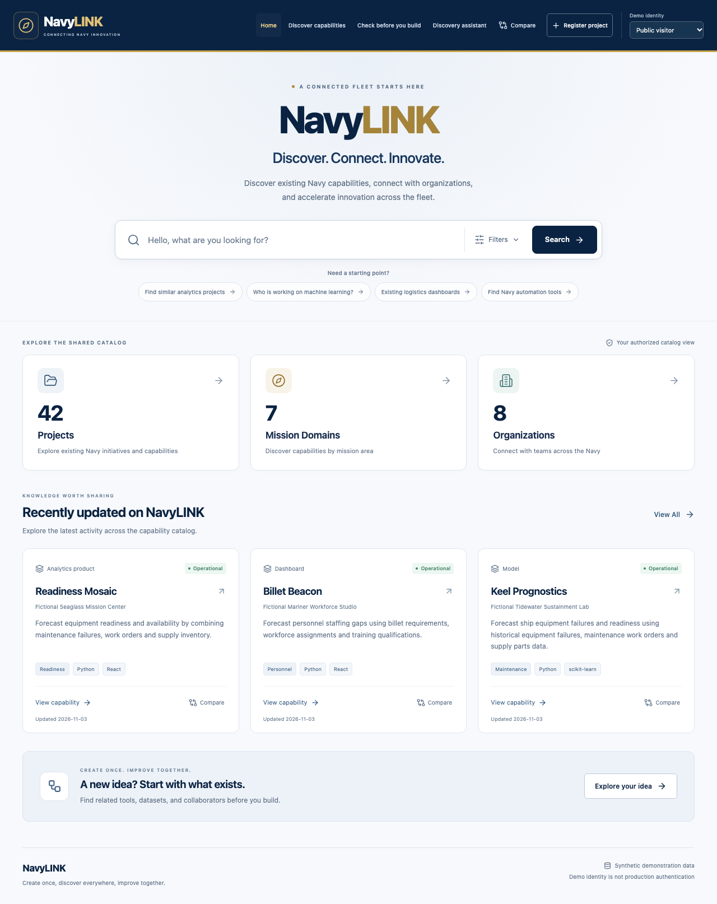

# NavyLINK

**Create once, discover everywhere, improve together.**

**Navy Locator for Innovation, Networking, and Knowledge.** A functional local capability discovery and reuse advisor for the November 4–6, 2026 FleetHacker demonstration.

All 56 projects, organizations, people, datasets and resource links are fictional. The application contains no operational Navy information. Default Public visitor can discover 42 records; Catalog curator can discover all 56. Access labels are application demo permissions, not classification markings.



The homepage provides search with supported filters, live catalog counts, mission-domain and organization directories, and recently updated projects. See the [homepage implementation and verification notes](docs/HOMEPAGE.md).

## Run locally

Requires Python **3.12+**, Node **22+**, npm, and SQLite with FTS5 (included in standard Python builds). Initial dependency installation requires networking. Runtime needs no internet, API key, external LLM or model download.

```sh
make setup PYTHON=python3.14  # or your installed Python 3.12+
make run
```

Open **http://127.0.0.1:8000**. FastAPI serves the compiled React app and API together. API documentation: **http://127.0.0.1:8000/docs**. SQLite persists in `data/navylink.db`. `make setup` creates `.env` from `.env.example` if absent. On this workspace dependencies, the compiled frontend and seeded database have already been created.

For live frontend development, run `make dev-api` and `make dev-ui` in separate terminals, then open http://127.0.0.1:5173. Vite proxies `/api` to the local API. It does not need CORS exposure.

```sh
make seed       # initialize only if the catalog is empty
make reset      # DESTRUCTIVE to demo catalog and agent history: restore fictional seed
make reindex    # rebuild persisted vectors and FTS5 documents after encoder changes
```

`make reset` preserves organization/domain lookup rows; visible facets derive exclusively from live authorized projects, so stale lookup rows are not exposed. Stop the server before resetting a demo.

## Implemented workflows

- Persistent registry with create, browse, read, partial update and delete; input validation, domain extensions, datasets, approved contacts, resources and access instructions.
- Natural-language search with keyword FTS5, local semantic vectors, configurable weighted Reciprocal Rank Fusion, filters applied before ranking, evidence snippets and transparent encoder reporting.
- Related projects use mission retrieval, datasets, domains, tags, technologies and stated use cases; comparison of two or three projects includes descriptions, intended users and highlighted shared attributes.
- **Check before you build** accepts a proposed name, mission or description, domain, intended users, datasets, technologies and desired capabilities. Only a mission problem or description is required. Five leads display initially, with expansion to all assessed candidates. Registration checks overlap before saving and the detail page can open a prefilled proposal.
- Bounded deterministic advisor: runs hybrid retrieval, expands related entries, inspects the records, compares overlap, evaluates reuse constraints, and produces a consolidated recommendation with field-level citations. Its real execution timeline streams to the interface with start/end times and durations.
- Assessments include selectable side-by-side comparison, separate duplicate/dataset/collaboration/complementary paths, and eight reuse checks per candidate. Completed local run URLs can be reloaded; changed record/contact permissions invalidate saved evidence.
- Dashboard metrics, lifecycle counts, recently updated projects and collaboration leads calculated from authorized records.
- **Discovery assistant** at `/assistant` answers questions using up to five authorized records, exact field citations, next steps, limitations and an execution summary. It supports optional configured OpenAI-compatible/Ollama generation and automatically falls back to structured deterministic answers.
- **Auto-Tag** in registration and the proposal form suggests editable metadata. Applying suggestions requires explicit review; stale suggestions must be refreshed. It never assigns owners, status, POCs or access permissions.
- Responsive React interface with local shadcn-style Button, Tailwind, Lucide, React Router and TanStack Query. No remote fonts, scripts or image dependencies.

## Search and overlap decisions

The default `bundled-concept-v1` encoder is a small, deterministic 512-dimensional mission-concept and token-hash baseline. Synonyms such as machinery/equipment, budget/financial and forecast/predictive map to common concepts. It is deliberately limited: it does not understand arbitrary language, negation or all mission nuances. It is **not a neural model**. Vectors persist with an encoder identifier; changes rebuild vectors on edits, and `make reindex` updates the entire catalog. Encoder mismatches are recomputed locally for visible entries during reads.

An optional **Sentence Transformers all-MiniLM-L6-v2** encoder supports richer local embeddings:

```sh
make model  # online setup: installs optional packages, saves model under data/models/
# Add to .env:
# NAVYLINK_MODEL_PATH=data/models/all-MiniLM-L6-v2
make reindex
make run
```

Runtime uses `local_files_only=True`, `trust_remote_code=False` and CPU execution. A missing configured model fails instead of silently reaching the internet or substituting an encoder. To return to the baseline, remove the model path, reindex and restart. Include `data/models/all-MiniLM-L6-v2` when transferring a neural-mode demo to another machine. The base Docker image includes the bundled encoder; optional neural dependencies and weights are not included in that image.

MiniLM weights have been prepared in this workspace. The test suite includes outbound-socket denial with offline environment flags set. See [evaluation results](docs/EVALUATION.md) and `docs/evaluation-neural.json` for the current observed results. Model artifacts are ignored by Git.

Hybrid retrieval fuses keyword and semantic ranks with rank constant 60. `NAVYLINK_SEMANTIC_WEIGHT` defaults to `0.55` (range 0–1). FTS queries use escaped token terms rather than raw FTS syntax. For this small catalog, lexical search creates an in-memory FTS5 index from the authorized filtered subset. This avoids hidden documents influencing BM25 statistics. SQLite also keeps a transactional persistent FTS document index. Vectors use no corpus-fitted vocabulary or training on hidden entries.

Duplicate assessment uses stated mission concepts, exact mission terms, project type, status and exact supplied dataset names. A potential duplicate needs broad concept coverage with supporting exact mission terms, or strong exact mission-term overlap. This also supports specific missions outside the concept vocabulary, such as hull corrosion inspection. Failure-prediction proposals require the candidate mission to state failure concepts. A dataset is classified as a relevant dataset; retired entries are historical references. Technology alone never establishes duplication. The mission ontology and overlap rules are inspectable in `encoding.py` and `advisor.py`.

Recommendations cite the exact authorized catalog field and value supporting a statement, linked to its project record. Eight reuse checks cover licensing, access, deployment, integration, datasets, support status, technology and approved contacts. Missing metadata stays unknown; stated terms still need confirmation. A proposed stack with no shared stated technologies is flagged as an unverified compatibility question. Technologies do not establish mission duplication. Dataset evidence uses exact names. No external actions, personnel contact or access requests are executed. See [agent behavior and API contract](docs/AGENT.md).

Phase 2 adds advisory relationships: **Potential Duplicate**, **Strongly Related**, **Complementary**, and **Weakly Related**. Mission evidence, domain, exact dataset/user/technology matches, deliverable type and status contribute to classification or relative ordering; similarity is never a duplicate probability. Different stated audiences downgrade a potential duplicate to a related lead; a proposed dataset can complement an application with a different deliverable. See [Phase 2 implementation and provider setup](docs/PHASE2.md).

Existing JSON catalog records remain intact when upgrading. Missing intended-user metadata displays as unknown. New seed fixtures include fictional intended users; use `make reset` only if you intend to replace the demo data. Older saved assessments expire as the response contract changes. `make reindex` refreshes persistent FTS documents; lexical queries build their current authorized index dynamically.

## Demo identities and permissions

The `X-Demo-User` header selects a **non-production identity**:

| Identity | Visible records | Editing |
| --- | --- | --- |
| `visitor` | Public entries | No |
| `analyst` | Public + internal entries | No |
| `maintainer` | Public + internal + maintenance-demo group | No |
| `curator` | Public + internal + maintenance-demo and finance-demo groups | Yes |

Add or override identities with `NAVYLINK_DEMO_USERS=/path/to/users.json`, a JSON array such as `[{"id":"reviewer","label":"Demo reviewer","internal":true,"groups":["maintenance-demo"],"editor":false}]`. Restart the server after configuration changes. The interface reads its identity options and editor role from the API. The editor role does not bypass record visibility.

Every search, related lookup, comparison, agent tool, RAG context, metadata suggestion, analytics response and facet uses authorized records. Hidden IDs return the same 404 as nonexistent records. Contact visibility is enforced separately. API responses are marked `no-store` and vary by demo identity. Agent runs belong to their creating identity. Catalog mutations invalidate runs, and retrieval also verifies an identity-scope fingerprint and authorized record snapshots, including contact visibility, before replaying evidence. Older workflow-version snapshots expire. Identity changes clear browser query and comparison state.

There are no export or relationship-graph endpoints in this milestone. A production deployment requires approved authentication, authorization, data handling, audit, transport and security controls. Anyone with local access can select a demo role; this is intentional for the demonstration. Bind only to loopback outside a specifically approved environment. Do not ingest controlled operational data into this prototype.

## Verification and evaluation

```sh
make test      # backend tests + TypeScript and production frontend build
make evaluate  # separate temporary seeded DB; writes docs/evaluation.json
# With make run active:
npm --prefix frontend test
```

Browser tests require a local Chromium installation: run `cd frontend && npx playwright install chromium` during online setup if needed. GitHub Actions installs it and runs the backend, build, evaluation and browser suite. CI configuration is provided; a hosted CI run has not been observed from this workspace.

See [evaluation report](docs/EVALUATION.md) for measured results and their limits. The harness includes 15 manually labeled queries, 10 known similar pairs, 10 unrelated pairs, five near-duplicate and five complementary/nonduplicate proposals, six permission checks, and a check of every cited field against its actual API record. The test suite runs the evaluation twice and requires repeatable outcomes. Tests cover related-entry expansion, real progress, canceled/failed runs, permission changes, uncertainty, metadata suggestions, both provider protocols and rejection of invented model facts/actions. Tests deny outbound sockets; browser tests block external HTTP while keeping loopback available.

## Offline packaging

After setup and build, `make run` uses only local dependencies, assets, SQLite and vectors. Keep `.venv` on its original platform; virtual environments are not portable across operating systems. To transfer the application, package the source with compatible offline dependency wheels/npm cache or prepare a container image on the target architecture before disconnecting.

```sh
docker compose build
docker compose up -d
# Open http://127.0.0.1:8000
docker compose exec navylink python -m navylink.seed --reset
docker save navylink:demo -o navylink-demo.tar
# On a compatible offline host: docker load -i navylink-demo.tar
docker compose up --no-build -d
```

The Compose named volume stores SQLite; the image ships seed definitions and creates the DB on first startup. Docker builds need internet access once for base images and dependencies. Container deployment is provided but has not been run on this host because Docker is unavailable. No claim of edge readiness, power efficiency or production deployment is made.

## Structure and next steps

`backend/navylink/` contains schema, database, authorization, registry, encoders, search, advisor and evaluation. `backend/tests/` verifies the workflows. `frontend/src/` contains the connected interface; `frontend/tests/` contains browser journeys. `docs/` includes architecture, measured evaluation, screenshots and a [three-minute demo script](docs/DEMO.md).

The next implementation milestone is independent retrieval evaluation with a larger, varied labeled catalog, followed by approved identity integration and a live test against an approved generation endpoint. Optional capability network visualization and synchronization are deferred. The default configuration needs no cloud service or LLM.
