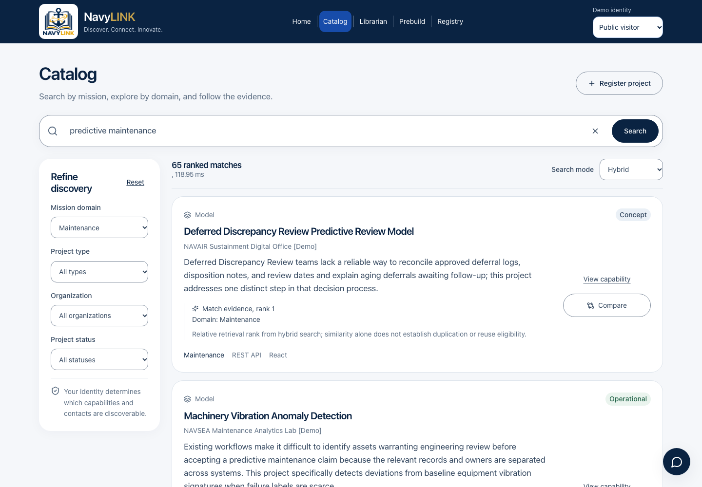
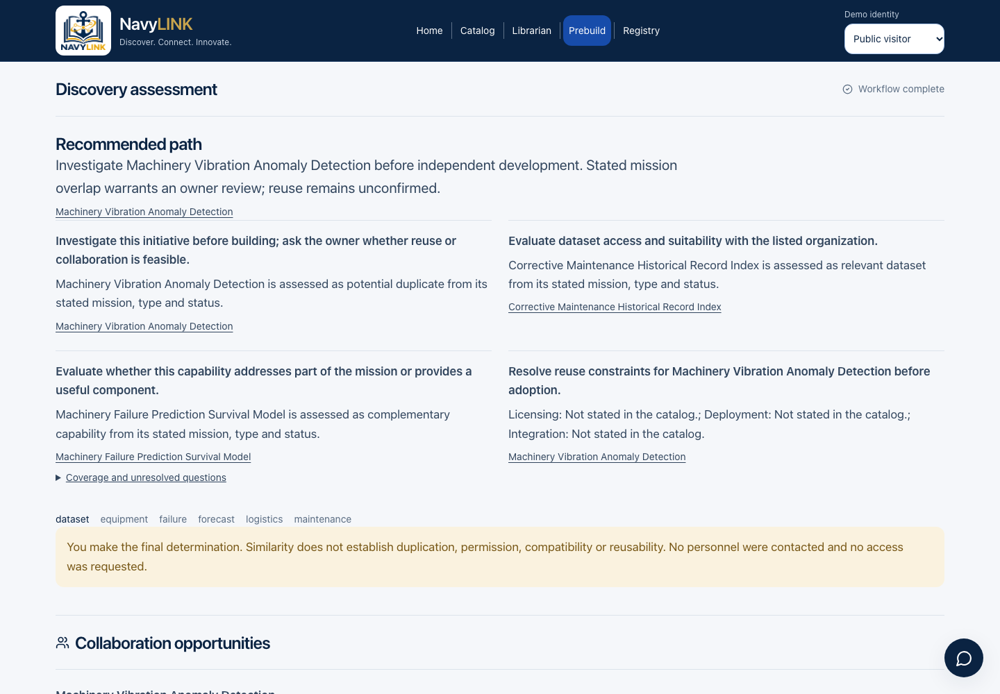
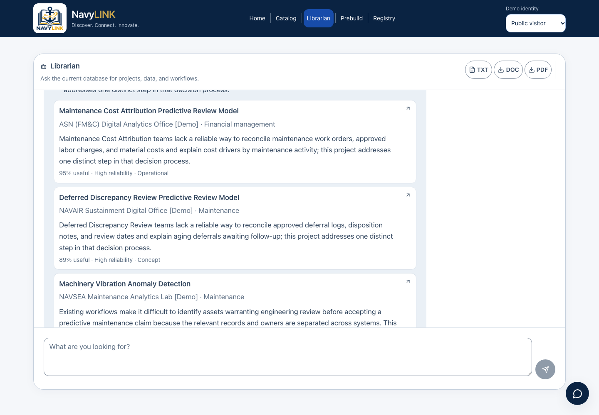

# NavyLINK

**Create once, discover everywhere, improve together.**

**Navy Locator for Innovation, Networking, and Knowledge** helps people find existing capabilities, assess overlap before building, and discover projects, datasets, and collaborators. It combines a React interface, a FastAPI API, and a local SQLite catalog for the November 4–6, 2026 FleetHacker demonstration.

All bundled projects, organizations, people, datasets, and resource links are fictional. The sample catalog contains **500 projects, 256 people, and 214 datasources**, all publicly discoverable demo records. A separate **56-project regression catalog** contains 42 public projects and role-restricted examples. Application access labels are demo permissions, not classification markings.


## What you can do

| Workflow | Where to start | Behavior |
| --- | --- | --- |
| Discover capabilities | **Catalog** · `/catalog` | Search in Hybrid, Keyword, Semantic, or SI Powered mode; filter by mission domain, type, organization, and status. Browsing shows 50 projects per page. |
| Inspect and compare | A project card · `/projects/{id}` | Read mission evidence, datasets, technologies, personnel, access instructions, and related capabilities. Select two or three projects to compare at `/compare`. |
| Check before building | **Prebuild** · `/check` | Describe a mission need, run a streamed local assessment, and inspect reuse leads, collaboration opportunities, citations, and eight reuse checks per candidate. |
| Ask the catalog | **Librarian** · `/librarian` | Ask freeform questions, find projects, or request a workflow. The floating chat shares the same session; `/assistant` is an alias. Export the conversation as TXT, DOC, or PDF. |
| Find people and data | **Registry** · `/people`, `/datasources` | Search personnel and datasource registries. Project metadata links to registered POCs, team members, and datasources. |
| Contribute records | `/projects/new` | Select **Catalog curator** to create, edit, or delete records. Registration checks overlap before saving; metadata suggestions remain editable and require review before applying. |

The homepage also provides live counts, mission-domain and organization directories, and recently updated projects. Counts and evidence always reflect the selected demo identity.

## Screenshots

Captured November 5, 2026 from the sample catalog using the bundled local encoder and no API keys. These are real browser captures of the running application.

**Catalog search** — ranked results with mission evidence and supported filters.



**Prebuild assessment** — a completed local workflow with a recommended path and linked catalog evidence.



**Librarian** — a catalog question answered locally, with matching project links and transcript exports.



More views: [project detail](docs/project.png), [proposal form](docs/phase2-proposal.png), [personnel registry](docs/registry.png), and [mobile homepage](docs/mobile.png). See the [screenshot guide](docs/SCREENSHOTS.md) to reproduce all eight captures.

## Run locally

Requires **Python 3.12+**, **Node 22+**, npm, Make, and SQLite with FTS5 (included in standard Python builds). Run commands from the repository root. Initial dependency installation needs internet access; the default runtime uses local assets, SQLite, and a bundled encoder, with no API key or model download required.

```sh
make setup                     # creates .venv and .env if needed; seeds and builds
# Or choose your Python explicitly: make setup PYTHON=python3.12
make run
```

Open **http://127.0.0.1:8000**. FastAPI serves the compiled frontend and API together. Interactive API documentation is at **http://127.0.0.1:8000/docs**; the health endpoint is **http://127.0.0.1:8000/api/health**. The default database is `data/navylink.db`.

`make setup` seeds the 56-project regression catalog only when the database is empty. To load the larger sample catalog shown above, stop the API and run:

```sh
PYTHONPATH=backend .venv/bin/python -m navylink.import_sample --dry-run
make sample                    # backs up SQLite, then replaces the catalog and run history
make run
```

The importer preserves sample IDs and historical dates and validates personnel/datasource references. Startup retains an existing catalog. See [sample import and backup instructions](docs/data/README.md#sample-catalog).

For live reload, run these in separate terminals, then open **http://127.0.0.1:5173**:

```sh
make dev-api
make dev-ui
```

Vite proxies `/api` to port 8000. Changes to `.env` require an API restart.

## Develop in a container

With Docker running and the VS Code Dev Containers extension installed, open the repository and choose **Dev Containers: Reopen in Container**. Setup installs Python 3.12, Node 22, project dependencies, and Playwright Chromium, initializes a separate development database, and builds the frontend. The startup hook starts the API at port 8000; `make run` starts it manually when needed.

Windows contributors should use Docker Desktop with WSL 2 and Linux containers. Python, Node, and Make are provided inside the container. The development database lives in its own named volume at `/var/lib/navylink/navylink.db`. See the [devcontainer guide](docs/DEVCONTAINER.md) for setup, testing, and persistence.

## Configuration

Copy `.env.example` to `.env` if you have not run `make setup`. Keep credentials in the ignored local `.env`; all provider requests run on the server.

| Setting | Default / purpose |
| --- | --- |
| `NAVYLINK_DB` | `data/navylink.db`; SQLite location. |
| `NAVYLINK_FRONTEND` | `frontend/dist`; compiled frontend location. |
| `NAVYLINK_SEMANTIC_WEIGHT` | `0.55`; semantic contribution to hybrid rank fusion, from 0 to 1. |
| `NAVYLINK_MODEL_PATH` | Unset; optionally load a prepared local Sentence Transformers model. |
| `NAVYLINK_DEMO_USERS` | Unset; optionally load a JSON file of demo identities. |
| `OPENAI_API_KEY`, `OPENAI_CHAT_MODEL` | Optional SI Powered reranking and Librarian generation. The model default in this repository is `gpt-6.1-terra`; use a model available to your account that supports the implemented requests. |
| `NAVYLINK_LLM_PROVIDER` | `none`; optional `openai` or `ollama` provider for question requests to `/api/v1/agent/discover`. |

**Hybrid**, **Keyword**, and **Semantic** search stay local. **SI Powered** (`mode=openai`) retrieves up to 50 authorized hybrid matches, sends the query and bounded project details to OpenAI for reranking, and accepts only a valid permutation of those candidates. It cannot introduce additional projects. Missing credentials or a failed ranking return an error.

**Librarian** uses the same SI Powered ranking when a key is configured, then answers from the top five projects in relevance order, including their descriptions and links. Ranking failures surface as errors; answer-generation failures keep the ranked project links and use a local answer template. Without a key, Librarian uses local catalog matching. Its displayed usefulness/reliability values are application heuristics, not measured probabilities or deployment approval.

The separate `/api/v1/agent/discover` question API supports constrained OpenAI-compatible or Ollama generation with local citation validation and deterministic fallback. The current Librarian interface uses `/api/v1/chat/catalog`. **Prebuild proposal assessments remain deterministic** regardless of provider settings.

For a fully local session, leave both `OPENAI_API_KEY` and `NAVYLINK_LLM_API_KEY` empty: the latter is also a fallback key for SI Powered and Librarian, even when `NAVYLINK_LLM_PROVIDER=none`. See the [configuration and troubleshooting guide](docs/CONFIGURATION.md) for all settings, provider behavior, and container overrides.

## Search and reuse assessment

Local hybrid retrieval combines FTS5 keyword and semantic ranks with weighted Reciprocal Rank Fusion (rank constant 60). Filters and authorization apply before ranking. Lexical queries build an in-memory FTS5 index from the authorized, filtered subset so hidden documents cannot affect BM25 statistics. SQLite also maintains persistent search documents and vectors.

The default **`bundled-concept-v1`** encoder is a deterministic, 512-dimensional mission-concept and token-hash baseline. It maps known synonyms but is not a neural model and has limited handling of arbitrary language, negation, and mission nuance. An optional local **Sentence Transformers all-MiniLM-L6-v2** encoder is available:

```sh
make model                     # online preparation: optional packages and model weights
# Add NAVYLINK_MODEL_PATH=data/models/all-MiniLM-L6-v2 to .env
make reindex
make run
```

Runtime uses local files only, CPU execution, and no remote model code. A missing configured model fails clearly. To return to the baseline, remove the model path, reindex, and restart. Model weights are ignored by Git and are not included in the base Docker image; transfer them separately when using neural mode offline.

Prebuild expands hybrid results through related projects, inspects records, compares candidates, and streams actual operation progress. Only a mission problem or description is required. Five leads appear initially, with expansion to all assessed candidates. Completed run URLs can be reloaded while their catalog evidence and identity scope remain valid.

Recommendations distinguish potential duplicates, related work, complementary capabilities, datasets, and historical references. Mission evidence drives duplication; shared technology alone does not establish it. Exact dataset and audience names provide supporting evidence. Each candidate includes checks for licensing, access, deployment, integration, datasets, support status, technology, and approved contacts. Missing metadata stays unknown, and stated terms still require confirmation. The application executes no personnel contact or access requests.

See the [agent behavior and API contract](docs/AGENT.md), [retrieval and provider details](docs/PHASE2.md), and [evaluation report](docs/EVALUATION.md) for decision rules and measured limitations.

## Demo identities and permissions

The identity selector sends an `X-Demo-User` header. This is a demonstration mechanism, not production authentication.

| Identity | Visible projects | Editing |
| --- | --- | --- |
| `visitor` | Public | No |
| `analyst` | Public + internal | No |
| `maintainer` | Public + internal + maintenance-demo group | No |
| `curator` | Public + internal + maintenance-demo and finance-demo groups | Yes |

All 500 sample projects are public, so use the separate regression fixtures to demonstrate restricted visibility. Search, related projects, comparisons, chat context, suggestions, analytics, and registries enforce visibility on the server. Contacts and registry references have additional visibility checks; unavailable IDs return the same 404 as missing records. The editor role does not bypass visibility.

Identity changes clear browser query, chat, and comparison state. Saved runs belong to their creating identity; catalog mutations and changed permissions invalidate evidence. API responses use `no-store` and vary by identity. Custom demo identities can be supplied through `NAVYLINK_DEMO_USERS`; see the [configuration guide](docs/CONFIGURATION.md#demo-identities).

A production deployment requires approved authentication, authorization, data handling, audit, transport, and security controls. Keep this fictional-data demo on loopback outside a specifically approved environment. Do not ingest controlled operational data.

## Verification and evaluation

```sh
make test                      # backend tests, TypeScript check, production frontend build
make evaluate                  # isolated seeded DB; writes docs/evaluation.json
cd frontend && npx playwright install chromium  # one-time browser installation
```

Run browser regression journeys against a fresh temporary database. In one terminal:

```sh
NAVYLINK_DB="$(mktemp -d)/navylink.db" NAVYLINK_MODEL_PATH= \
  OPENAI_API_KEY= NAVYLINK_LLM_API_KEY= NAVYLINK_LLM_PROVIDER=none \
  PYTHONPATH=backend .venv/bin/python -m uvicorn navylink.main:app \
  --host 127.0.0.1 --port 8013
```

In another terminal, from the repository root:

```sh
NAVYLINK_TEST_URL=http://127.0.0.1:8013 npm --prefix frontend test
```

The two sample-import journeys require the 500-project catalog instead. With a sample server running at port 8000:

```sh
NAVYLINK_SAMPLE_TEST=1 npm --prefix frontend test -- sample-import.spec.ts
```

The regression browser suite writes screenshots to `docs/`; run the [sample screenshot capture](docs/SCREENSHOTS.md) afterward to restore the README gallery. The capture script checks sample counts, completed assessment and chat responses, mobile overflow, browser errors, and external asset requests.

The [evaluation harness](docs/EVALUATION.md) covers 15 labeled queries, 10 known similar pairs, 10 unrelated pairs, five near-duplicate and five complementary/nonduplicate proposals, six permission checks, and exact cited-field verification. These are synthetic fixture measurements, not independent real-world performance claims. GitHub Actions is configured to run backend, build, evaluation, and browser checks.

## Docker and offline packaging

```sh
docker compose build
docker compose up -d
# Open http://127.0.0.1:8000
docker compose logs -f navylink
```

The image builds the frontend, installs backend dependencies, and imports the sample CSVs into its database during the image build. A new Compose `navylink-data` volume receives that database; an existing volume retains its catalog across rebuilds. The image includes CSVs at `/app/sample` for explicit replacement:

```sh
docker compose stop navylink
docker compose run --rm navylink python -m navylink.import_sample --directory /app/sample --replace
docker compose up -d
```

This replaces catalog records and workflow history after making a database backup in the volume. Compose forwards only the environment variables listed in `compose.yaml`; the image excludes `.env`. SI Powered and Librarian credentials need the [documented Compose override](docs/CONFIGURATION.md#docker-configuration).

Prepare the image online before moving to a compatible offline host:

```sh
docker save navylink:demo -o navylink-demo.tar
# Transfer the archive and compose.yaml to a compatible host, then:
docker load -i navylink-demo.tar
docker compose up --no-build -d
```

Database contents in an existing named volume are separate from the image archive. For native offline use, prepare dependencies and the frontend first; Python virtual environments must remain on their original platform. Optional external providers need connectivity, while the default local workflows do not. Container deployment was not exercised during this documentation refresh; no production or edge-readiness claim is made.

## Project documentation

| Guide | Contents |
| --- | --- |
| [Architecture](docs/ARCHITECTURE.md) | Components, retrieval, persistence, and authorization boundaries. |
| [Configuration](docs/CONFIGURATION.md) | Environment variables, provider paths, Docker overrides, and troubleshooting. |
| [Catalog fields and sample import](docs/data/README.md) | Project, personnel, and datasource contracts; import and backup behavior. |
| [Demo walkthrough](docs/DEMO.md) | Three-minute sample-catalog tour and optional regression permission demo. |
| [Screenshots](docs/SCREENSHOTS.md) | Capture inventory and reproducible isolated setup. |
| [Agent contract](docs/AGENT.md) | Streamed workflow, bounds, citations, and saved assessments. |
| [Provider and retrieval details](docs/PHASE2.md) | Advisory relationships and constrained question-generation API. |
| [Evaluation](docs/EVALUATION.md) | Measured fixture results and limits. |
| [Dev containers](docs/DEVCONTAINER.md) | Cross-platform setup, dependency updates, and persistent development data. |
| [Homepage implementation](docs/HOMEPAGE.md) | Homepage components and original verification notes. |

Source lives in `backend/navylink/` and `frontend/src/`; tests live in `backend/tests/` and `frontend/tests/`. `data/sample/` contains the fictional CSV catalog. Relationship graphs, synchronization, production identity integration, and independent retrieval evaluation remain future work.
