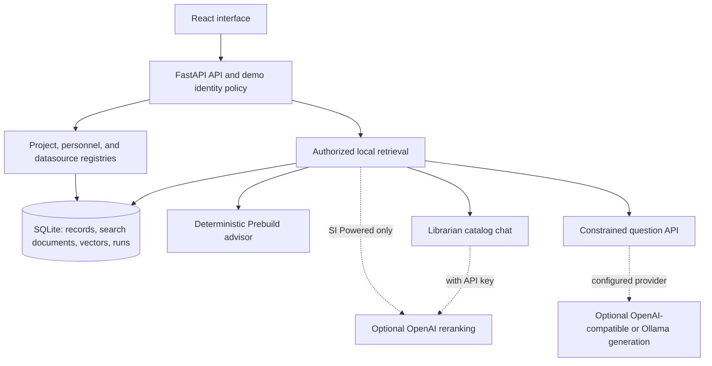

# NavyLINK architecture

NavyLINK runs a React/Vite frontend and a FastAPI backend backed by SQLAlchemy and SQLite. FastAPI serves the production frontend and canonical `/api/v1` endpoints from one process. During development, Vite proxies `/api` to the API on port 8000. All bundled data is fictional.

## Components and persistence

| Location | Responsibility |
| --- | --- |
| `backend/navylink/main.py` | API routes, dependency-based demo identities/editor checks, streaming responses, and frontend serving. |
| `database.py`, `migrations.py`, `registry.py`, `catalog_records.py` | Database schema, compatibility migrations, transactional project writes, personnel/datasource CRUD, and reference integrity. |
| `auth.py` | Authorized subsets, contact/reference redaction, and demo identity configuration. |
| `encoding.py`, `search.py`, `openai_search.py` | Local vectors, FTS5/hybrid retrieval, related-project retrieval, and optional bounded reranking. |
| `advisor.py`, `evidence.py` | Proposal assessment, comparison, reuse checks, streamed workflow, citations, and saved-run validation. |
| `catalog_chat.py` | Librarian retrieval, optional OpenAI answer generation, and local templates. |
| `rag.py`, `generation.py`, `rag_schemas.py` | Separate constrained question-answering API with validated extractive generation. |
| `suggestions.py` | Editable metadata suggestions; applying them requires UI review. |
| `seed.py`, `import_sample.py`, `reindex.py`, `evaluate.py` | Fixture initialization, backed-up sample replacement, index rebuilding, and isolated evaluation. |
| `frontend/src/` | React Router views, TanStack Query state, shared Librarian session, forms, and local assets. |
| `backend/tests/`, `frontend/tests/` | Backend verification and Playwright browser journeys. |

Projects store validated JSON metadata with normalized organization/domain lookups, persisted embeddings, and search documents. Personnel and datasources are separate records referenced by projects. Metadata, vector, and FTS document updates commit together. Registry mutations invalidate saved advisor runs.

Startup migrates existing catalogs and seeds only an empty project catalog. Native `make setup` initializes the 56-project regression fixtures; `make sample` explicitly replaces them with the 500-project CSV catalog after backup. The Docker image imports the sample catalog during build. Existing native databases and Docker named volumes persist across restarts. See [catalog fields and imports](data/README.md).

## Retrieval and authorization

Every retrieval begins with the authorized, filtered subset. Search constructs an in-memory FTS5 index from that subset, preventing hidden documents from influencing BM25 statistics. SQLite also retains a transactional persistent FTS index. The bundled encoder maps known mission concepts and hashes remaining terms into normalized vectors without learning from hidden records. Optional prepared Sentence Transformers embeddings load locally on CPU. Weighted Reciprocal Rank Fusion combines lexical and semantic ranks with rank constant 60.

Demo identity headers are not authentication. Visibility applies to projects, people, and datasources; contacts and references are redacted independently. Unavailable IDs return the same 404 as missing records. Facets, counts, comparisons, related results, suggestions, and generation context use authorized representations. API responses are noncacheable and vary by identity; frontend identity changes clear query, comparison, and chat state.

## Workflow and generation paths

**Prebuild** uses a bounded deterministic state machine. It streams NDJSON progress before and after actual operations, merges hybrid and related-project findings, inspects records, compares candidates, and synthesizes cited next steps. A shared iterator drives streaming and complete-JSON responses. Citations preserve exact authorized field values. Saved runs belong to their creating identity and carry scope/record fingerprints that must still match on replay. See the [agent contract](AGENT.md) for bounds and decision rules.

**Librarian** calls `/api/v1/chat/catalog` from its full-page and floating interfaces. With no key, it uses local matching and templates. With an OpenAI key, it uses the same bounded reranking as SI Powered search, then asks OpenAI to answer from the five selected records and recent chat history. Reranking validates that returned IDs exactly match the candidate set. Librarian answer prose is separate from the extractive validation contract below. Ranking failures surface as errors; generation failures retain the ranked records and return a local template. Chat state lives in the browser session; transcript export happens in the browser.

**Question input to `/api/v1/agent/discover`** follows a separate retrieval/generation path. Optional OpenAI-compatible or Ollama generation may select retrieved project IDs, exact field quotes, and allowed action codes. Local validation rejects invented fields, sources, quotes, or actions and falls back deterministically. These `NAVYLINK_LLM_*` provider settings do not select Librarian's endpoint. See [configuration](CONFIGURATION.md) and [provider details](PHASE2.md).

The default runtime needs no cloud service, model download, or external action integration. Optional SI Powered and Librarian calls send authorized catalog context to OpenAI; the separate question API may call its configured provider. Neither path executes personnel contact or access requests. Similarity, relationship labels, and usefulness/reliability heuristics are advisory evidence rather than permissions or probability estimates.

Production identity integration, relationship graphs, synchronization, and independent real-world retrieval evaluation remain future work. A production deployment also requires approved data handling, audit, transport, and security controls.
