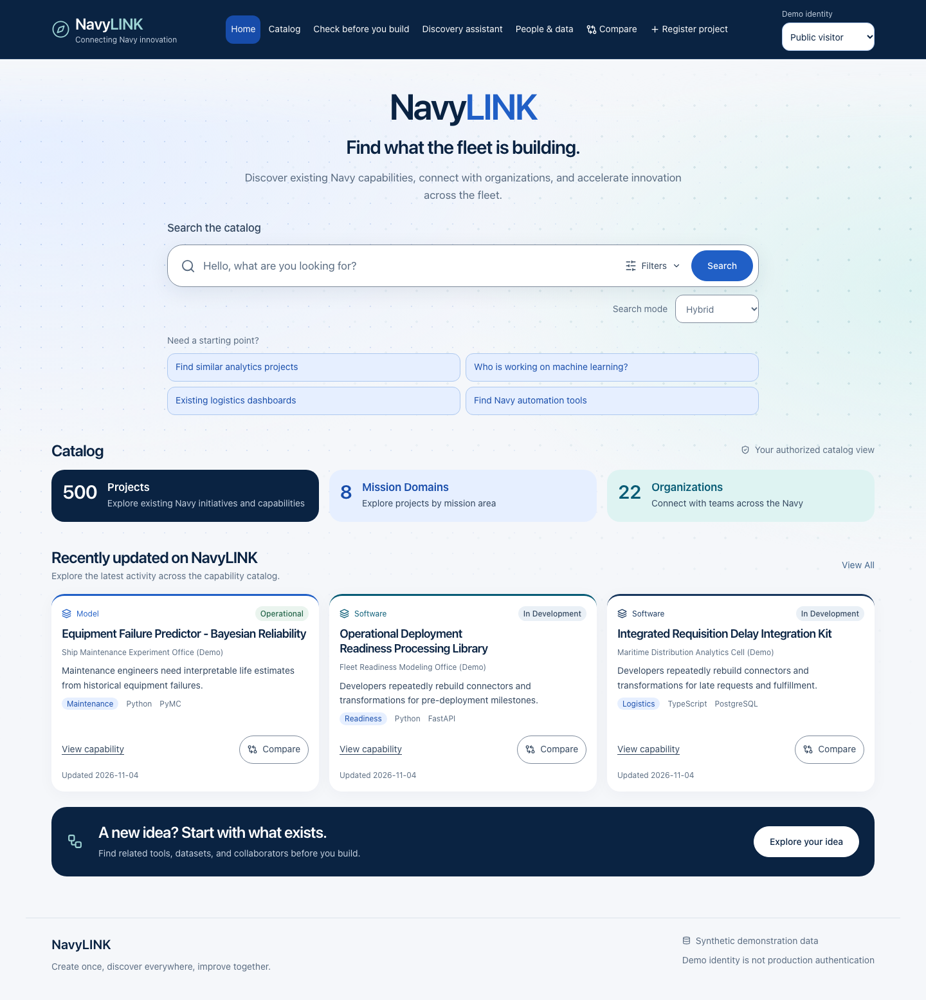

# NavyLINK homepage redesign

The homepage now follows the discovery layout in the supplied brief: a full-width navy and gold header, centered NavyLINK hero, prominent search, three live discovery cards, and recent project cards. The existing proposal workflow remains available through the header and the “Explore your idea” callout.

## Components and files

| File | Responsibility |
| --- | --- |
| `frontend/src/components/app-header.tsx` | `AppHeader`: branding, all existing navigation destinations, comparison count, demo identity, and collapsible navigation with Escape handling. |
| `frontend/src/components/homepage.tsx` | `HomePage`, `HomeSearch`, and `DiscoveryCard`: hero, submitted searches with selectable search modes, expandable filters, suggestion chips, live counts, recent projects, and loading/error/empty states. |
| `frontend/src/components/discovery-directory.tsx` | `DiscoveryDirectory`: authorized mission-domain and organization browsing pages. |
| `frontend/src/catalog-filters.ts` | Shared search-mode, project-type and status values supported by the API. |
| `frontend/src/homepage.css` | Responsive header, homepage, directories, footer, and shared shell styles. |
| `frontend/src/main.tsx` | Integration with existing routes, identity and comparison state; directory routes; catalog clear-search control and preservation of selected filters when changing a query. |
| `frontend/src/styles.css` | Removed the previous homepage rules; retained existing workflow styles. |
| `frontend/tests/homepage.spec.ts` | Seven browser tests covering API-backed counts, directories, all three search modes with filters, suggestions, loading/error/retry/empty states, and responsive keyboard navigation. |
| `frontend/tests/workflows.spec.ts` | Updated homepage assertions and shortcuts for the redesigned navigation. |
| `README.md`, `docs/HOMEPAGE.md` | Redesign notes and entry point. |

The existing `ProjectCard` is reused, including its project-detail links and comparison controls. Browser verification refreshed `docs/dashboard.png`, `docs/mobile.png`, `docs/advisor.png`, `docs/assistant.png`, and `docs/phase2-proposal.png` to show the new shared header.

## Routes and data

Existing routes remain available. Two frontend routes were added:

- `/domains`: mission-domain directory; each entry opens `/catalog?domain=…`.
- `/organizations`: organization directory; each entry opens `/catalog?organization=…`.

No backend endpoints, API schemas, search algorithms, authentication rules, or dependencies were changed for this redesign. Existing APIs supply all data:

| API | Usage |
| --- | --- |
| `GET /api/v1/analytics/overview` | Total projects, distinct visible mission domains, and recently updated project records. |
| `GET /api/v1/organizations` | Organization count, organization filter, and directory. |
| `GET /api/v1/search` | Submitted queries with supported `project_type`, `domain`, `organization`, and `status` filters. Both the homepage and catalog offer Hybrid, Keyword/FTS5, and Semantic modes. |
| `GET /api/v1/projects/page` | Paginated browsing with filters and no query. |

The main navigation and catalog page use the label **Catalog**. The homepage defaults to Hybrid search; its always-visible Search mode dropdown also offers Keyword and Semantic. Submitted queries and suggestion chips carry the chosen mode and filters to the catalog, where changing the query preserves those selections. Empty queries browse filtered projects while retaining the chosen mode for the next search. Clearing homepage filters leaves the mode selected.

Queries retain the current `X-Demo-User` identity. Counts and directory entries reflect authorized records, and changing identities clears cached evidence and comparison selections. There are no fixed statistics in the UI. The seed catalog currently gives Public visitor 42 projects, 7 mission domains, and 8 organizations; the tests also check Catalog curator against API responses.

## Verification

Verified on November 4, 2026:

- `npm --prefix frontend run build`: TypeScript and Vite production build passed.
- `NAVYLINK_TEST_URL=http://127.0.0.1:8013 npm --prefix frontend test`: **20 passed**, with the two sample-import checks skipped, against a local server with a separate temporary SQLite regression database.
- Responsive browser checks passed at 320, 360, 375, 390, 600, 768, 1024, 1190, 1280, and 1440 pixels, with filters expanded and no horizontal overflow. All recent project cards remain visible at tablet sizes.
- Keyboard checks cover Enter to search, focus after clearing search, and Escape to close navigation and return focus. External HTTP was blocked in the responsive and existing offline workflow tests; no external requests or page errors were observed in the responsive check.
- The existing search → detail → related → compare, advisor, saved-run, assistant, identity-boundary, and create/edit/delete journeys passed.

No lint command is configured in the repository. The production build provides the configured TypeScript check.

## Scope and limitations

There are no unfinished required features. The section is labeled **Recently updated on NavyLINK** because the dataset does not expose a reliable popularity metric. Suggestion chips execute the requested example queries; live autocomplete is not added because the existing API does not support it. Project type and status use the existing schema enums; keywords and technologies remain part of the search query rather than disconnected frontend filters.

The data and identities remain the application's fictional demonstration catalog. No external fonts, image services, or additional packages are required. The compass mark uses the existing Lucide icon library.

[Mobile homepage screenshot](mobile.png)
